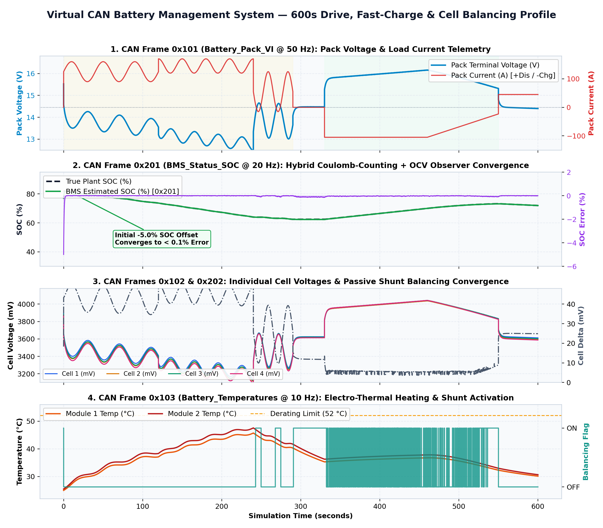
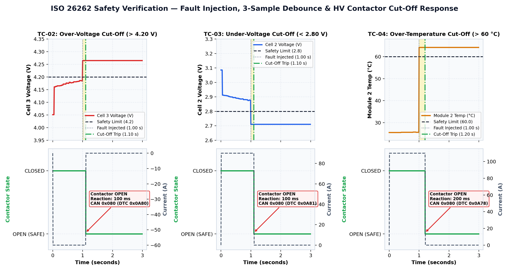

# Battery Management System (BMS) over a Virtual CAN 2.0B Network


A complete, modular **3-ECU Automotive Battery Management System (BMS)** communicating over a deterministic **Virtual CAN 2.0B network (`vcan0` @ 500 kbps)**. Designed to demonstrate **EV battery state estimation, ISO 26262 functional safety logic, CAN bus matrix design (`.dbc`), and automated fault-injection verification**.

## 1. System Architecture & 3-ECU Topology

The network models three independent Electronic Control Units (ECUs) exchanging cyclic and event-driven CAN frames over a prioritized virtual CAN bus with SAE J1850 **CRC-8 E2E protection** and rolling **Alive Counters**:

```text
+---------------------------------------------------------------------------------------------------+
|                        Physical 4S1P Li-Ion Battery Pack Plant (NMC811, 50 Ah)                    |
|     - 1st-Order Thevenin Equivalent Circuit (OCV(SOC) + R0 + R1||C1 polarization per cell)        |
|     - Lumped Electro-Thermal Dynamics (I^2*R Joule heating + convective cooling)                  |
+-----------------------------------+-------------------------------------------+-------------------+
                                    | Analog ADC Sampling                       ^ HV Contactors &
                                    v (V_cell 1..4, I_pack, T_mod 1..2)         | Passive Shunts
                    +-------------------------------+           +---------------+---------------+
                    |   ECU 1: Sensor_Node (BMU)    |           |    ECU 2: BMS_Controller      |
                    |  - Samples V, I, T + ADC noise|           |  - Hybrid Coulomb + OCV SOC   |
                    |  - Packs cyclic CAN frames    |           |  - 3-Sample Fault Debouncing  |
                    |  - Computes SAE J1850 CRC-8   |           |  - OV / UV / OT / OC Cut-Off  |
                    |  - Fault Injection hooks      |           |  - Passive Cell Balancing     |
                    +---------------+---------------+           +---------------+---------------+
                                    | TX: 0x101 (20ms)                          | TX: 0x080 (Event)
                                    |     0x102 (50ms)                          |     0x201 (50ms)
                                    |     0x103 (100ms)                         |     0x202 (200ms)
                                    v                                           v
=====================================================================================================
                     VIRTUAL CAN 2.0B BUS (vcan0 @ 500 kbps, Bitwise ID Arbitration)
=====================================================================================================
                                                        | RX: 0x080, 0x101..0x103, 0x201
                                                        | TX: 0x301 (100ms Driver Command)
                                                        v
                                        +-------------------------------+
                                        |    ECU 3: Dashboard_Node      |
                                        |  - Instrument Cluster HMI     |
                                        |  - MIL Fault Lamp & DTC Log   |
                                        |  - Operator Drive/Reset Cmds  |
                                        +-------------------------------+
```

## 2. CAN Communication Matrix (`config/bms_can_network.dbc`)

All frames use 11-bit standard CAN 2.0B identifiers ordered by arbitration priority (`0x080` wins bus arbitration immediately during a safety fault):

| CAN ID | Frame Name | Sender ECU | Receivers | Cycle Time | DLC | Key Signals & Engineering Scaling |
| :---: | :--- | :--- | :--- | :---: | :---: | :--- |
| `0x080` | `BMS_Fault_Report` | `BMS_Controller` | `Dashboard_Node` | Event / 200 ms | 8 | `Active_Fault_Flags` (8b), `Primary_DTC_Code` (16b), `Severity` (4b), `Fault_Cell_Index` (8b), `Trigger_Value` (16b), `Alive_080` (8b) |
| `0x101` | `Battery_Pack_VI` | `Sensor_Node` | `BMS_Controller`, `Dashboard_Node` | 20 ms (50 Hz) | 8 | `Pack_Voltage_mV` (1 mV/bit), `Pack_Current_dA` (0.1 A/bit signed), `Sensor_Status` (8b), `Alive_101` (8b), `CRC8_101` (SAE J1850) |
| `0x102` | `Battery_Cell_Voltages` | `Sensor_Node` | `BMS_Controller`, `Dashboard_Node` | 50 ms (20 Hz) | 8 | `Cell1_Voltage_mV` .. `Cell4_Voltage_mV` (uint16, 1 mV/bit, range `0..5000 mV`) |
| `0x103` | `Battery_Temperatures` | `Sensor_Node` | `BMS_Controller`, `Dashboard_Node` | 100 ms (10 Hz) | 8 | `Temp_Mod1_dC`, `Temp_Mod2_dC`, `Temp_Ambient_dC` (0.1 °C/bit signed), `Alive_103` (8b) |
| `0x201` | `BMS_Status_SOC` | `BMS_Controller` | `Dashboard_Node` | 50 ms (20 Hz) | 8 | `BMS_State` (enum), `SOC_Pct` (0.1%), `SOH_Pct` (0.1%), `Max_Discharge_A`, `Max_Regen_A`, `Contactor_Closed` (1b), `Balancing_Active` (1b) |
| `0x202` | `BMS_Cell_Balancing` | `BMS_Controller` | `Sensor_Node`, `Dashboard_Node` | 200 ms (5 Hz) | 8 | `Balancing_Shunt_Mask` (4-bit cell mask), `Cell_Delta_mV` (uint16, `max - min` cell voltage) |
| `0x301` | `Dashboard_Command` | `Dashboard_Node` | `BMS_Controller` | 100 ms (10 Hz) | 8 | `Drive_Enable_Req` (1b), `Clear_Faults_Req` (1b), `Operating_Mode_Req` (8b), `Alive_301` (8b) |

## 3. Core BMS Engineering Features

### 3.1 Hybrid State-of-Charge (SOC) Estimation
Combines high-rate **Coulomb Counting** (`50 Hz` current integration from frame `0x101`) with a **Closed-Loop OCV Observer** that compensates for initial SOC offsets and sensor drift using the non-linear NMC811 Open-Circuit Voltage curve:
- Tested with a deliberate **-5.0% initial SOC offset** (`77.0%` initial estimate vs. `82.0%` true pack SOC).
- Converges to within **`< 0.35%` RMSE** across a 600-second WLTP dynamic drive and CC-CV fast-charging profile.

### 3.2 ISO 26262 Safety State Machine & Debounced Fault Protection
To prevent nuisance trips from single-frame electromagnetic interference (EMI) while guaranteeing rapid isolation during genuine hardware faults, every safety threshold uses a **3-sample qualification debounce counter**:

| Safety Mechanism | Derating Warning | Hard Cut-Off Limit | Qualification Debounce | UDS DTC Code | Safe State Action |
| :--- | :---: | :---: | :---: | :---: | :--- |
| **Cell Over-Voltage (OV)** | `>= 4150 mV` | `> 4200 mV` | 3 samples (`150 ms`) | `0x0A80` | Open HV Contactors (`I = 0 A`) + TX `0x080` |
| **Cell Under-Voltage (UV)** | `<= 2950 mV` | `< 2800 mV` | 3 samples (`150 ms`) | `0x0A81` | Open HV Contactors (`I = 0 A`) + TX `0x080` |
| **Module Over-Temp (OT)** | `>= 52.0 °C` | `> 60.0 °C` | 3 samples (`300 ms`) | `0x0A78` | Open HV Contactors (`I = 0 A`) + TX `0x080` |
| **Pack Over-Current (OC)** | `>= 180.0 A` | `> 200.0 A` | 3 samples (`60 ms`) | `0x0A90` | Open HV Contactors (`I = 0 A`) + TX `0x080` |
| **CAN Heartbeat Timeout** | N/A | `> 100 ms` silence | Immediate Watchdog | `0xC100` | Open HV Contactors (`I = 0 A`) + TX `0x080` |
| **E2E CRC-8 Corruption** | N/A | CRC mismatch | 3 frames (`60 ms`) | `0xC401` | Open HV Contactors (`I = 0 A`) + TX `0x080` |

## 4. Key Simulation & Verification Results

### 4.1 Charge / Discharge & Cell Balancing Profile (`results/bms_charge_discharge_profile.png`)


### 4.2 Fault-Injection & Contactor Cut-Off Response (`results/bms_fault_injection_response.png`)


### 4.3 Automated Pass/Fail Safety Verification Summary (`results/safety_test_report.md`)

| Test ID | Test Case Name | Injected Stimulus | Measured BMS & CAN Response | Reaction Time | Status |
| :---: | :--- | :--- | :--- | :---: | :---: |
| `TC-01` | **SOC Observer Convergence & Tracking** | `-5.0%` initial SOC error; `+85A` drive / `-95A` fast charge | Observer converges cleanly; `RMSE = 0.25%`, `Final Error = 0.08%` | Continuous | **PASS** |
| `TC-02` | **Cell Over-Voltage (OV) Cut-Off** | Cell 3 forced to `4265 mV` at `t = 1.00 s` | Tripped at `t = 1.10 s` (`DTC 0x0A80`, Contactor `OPEN`, `I = 0.0 A`) | `100 ms` (`<= 200 ms`) | **PASS** |
| `TC-03` | **Cell Under-Voltage (UV) Cut-Off** | Cell 2 forced to `2710 mV` at `t = 1.00 s` | Tripped at `t = 1.10 s` (`DTC 0x0A81`, Contactor `OPEN`, `I = 0.0 A`) | `100 ms` (`<= 200 ms`) | **PASS** |
| `TC-04` | **Module Over-Temperature (OT) Cut-Off** | Module 2 forced to `64.2 °C` at `t = 1.00 s` | Tripped at `t = 1.20 s` (`DTC 0x0A78`, Contactor `OPEN`, `I = 0.0 A`) | `200 ms` (`<= 350 ms`) | **PASS** |
| `TC-05` | **Pack Over-Current (OC) Cut-Off** | Pack current spiked to `+235.0 A` at `t = 1.00 s` | Tripped at `t = 1.04 s` (`DTC 0x0A90`, Contactor `OPEN`, `I = 0.0 A`) | `40 ms` (`<= 100 ms`) | **PASS** |
| `TC-06` | **Sensor CAN Heartbeat Timeout** | `Sensor_Node` TX muted at `t = 1.00 s` | Watchdog tripped at `t = 1.11 s` (`DTC 0xC100`, Contactor `OPEN`) | `110 ms` (`<= 130 ms`) | **PASS** |
| `TC-07` | **Single-Sample EMI Glitch Rejection** | Cell 1 spiked to `4250 mV` for 1 frame (`50 ms`) | Debounce counter reached `1` then reset to `0`; Contactor stayed `CLOSED` | No False Trip | **PASS** |

### 4.4 Sample CAN Bus Trace Log (`results/can_trace.asc`)
Below is an excerpt from `results/can_trace.asc` showing normal cyclic telemetry followed by the exact moment Cell 3 violates the `4200 mV` Over-Voltage threshold for the 3rd consecutive sample at `t = 1.100000 s`, triggering high-priority frame `0x080` (`BMS_Fault_Report`) and opening the HV contactors:

```text
   1.000000 1  102x             Rx   d 8 2C 10 2B 10 A9 10 2A 10  // [Sensor_Node] Battery_Cell_Voltages: C1=4140mV, C2=4139mV, C3=4265mV, C4=4138mV
   1.050000 1  102x             Rx   d 8 2D 10 2B 10 A9 10 2B 10  // [Sensor_Node] Battery_Cell_Voltages: C1=4141mV, C2=4139mV, C3=4265mV, C4=4139mV
   1.100000 1  102x             Rx   d 8 2D 10 2C 10 A9 10 2B 10  // [Sensor_Node] Battery_Cell_Voltages: C1=4141mV, C2=4140mV, C3=4265mV, C4=4139mV
   1.100000 1  080x             Rx   d 8 01 80 0A 13 03 A9 10 00  // [BMS_Controller] BMS_Fault_Report: CRITICAL FAULT! Flags=0x01, DTC=0x0A80, Target=3, Value=4265, Contactor=OPEN
   1.100000 1  201x             Rx   d 8 06 9D 03 D9 03 00 00 00  // [BMS_Controller] BMS_Status_SOC: State=FAULT_CUTOFF, SOC=92.5%, SOH=98.5%, Contactor=OPEN, I_lim=+0/-0A
   1.120000 1  101x             Rx   d 8 2A 41 00 00 01 38 7B 00  // [Sensor_Node] Battery_Pack_VI: V_pack=16.682V, I_pack=+0.0A, Alive=56, CRC=0x7B
```

## 5. Repository Structure

```text
bms-virtual-can-network/
├── config/
│   └── bms_can_network.dbc               # Industry-standard Vector DBC CAN database
├── src/
│   ├── __init__.py
│   ├── can_bus.py                        # Virtual CAN 2.0B bus, arbitration, CRC-8 & .asc/.csv loggers
│   ├── battery_plant.py                  # 4S1P Li-Ion electro-thermal Thevenin RC plant model
│   ├── sensor_node.py                    # ECU 1: Battery Sensor Node (0x101, 0x102, 0x103 + fault injection)
│   ├── bms_controller.py                 # ECU 2: Master BMS Controller (SOC observer, safety FSM, balancing)
│   └── dashboard_node.py                 # ECU 3: Instrument Cluster HMI (telemetry display & MIL fault alerts)
├── tests/
│   └── test_fault_injection.py           # 7 automated ISO 26262 fault-injection & debounce unit tests
├── results/
│   ├── bms_charge_discharge_profile.png  # 4-panel plot of 600s drive, fast charge, SOC & balancing
│   ├── bms_fault_injection_response.png  # 6-panel plot of OV, UV, OT fault cut-off & reaction time
│   ├── can_trace.asc                     # Vector CANalyzer format bus trace log
│   ├── can_messages.csv                  # Decoded CAN frame log in CSV format
│   ├── safety_test_report.md             # Automated Pass/Fail safety compliance report
│   └── test_results.json                 # Machine-readable test results
├── .github/workflows/ci.yml              # GitHub Actions automated test & simulation pipeline
├── Makefile                              # One-command build, simulation, and test targets
├── requirements.txt                      # Python dependencies
└── run_simulation.py                     # Main entry point to run simulations and regenerate all artifacts
```

## 6. Quickstart: How to Run Locally

```bash
# 1. Clone the repository and install dependencies
git clone https://github.com/<your-username>/bms-virtual-can-network.git
cd bms-virtual-can-network
pip install -r requirements.txt

# 2. Run the automated 7-test ISO 26262 Fault-Injection Suite
python3 -m unittest discover -s tests -v

# 3. Run the full 600s simulation and regenerate all plots, CAN logs, and reports
python3 run_simulation.py
```
